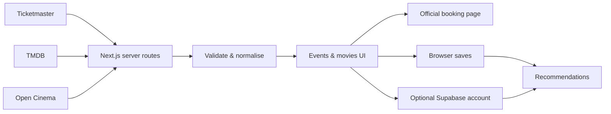

<div align="center">
  

  <h3>Find something worth going out for in Auckland.</h3>

  <p>Concerts, theatre, markets, festivals and movies in one bilingual guide — sorted by what's coming up soon.</p>

  <p>
    <a href="https://kiwicue.nz"><strong>🥝 Open kiwicue.nz →</strong></a>
  </p>

  <p>
    
    
    
    
    
  </p>
</div>

<p align="center">
  
  &nbsp;
  
</p>

> **中文简介：** KiwiCue（纽村小报）是一个中英双语的奥克兰活动与电影指南。演唱会、话剧、市集、节日和电影场次集中在一个地方，按时间排序，一键跳转官方购票页面。无需注册即可浏览和收藏；登录后可跨设备同步。

---

## What you can do

| | |
| --- | --- |
| 🔎 **Discover** | Browse by category or tap a quick filter — *Tonight*, *This weekend*, *Free*, *Live music*, or *Surprise me*. Search by event name or venue. |
| 🗺️ **Plan** | See dates, venues and maps at a glance, then go straight to the official ticket page. |
| 🎬 **Movies** | Find verified Auckland cinema sessions and new releases, and sort cinemas by distance. |
| ⭐ **Picks & For You** | Get explainable recommendations — every pick says *why* it was suggested. |
| ❤️ **Save** | Save events without an account. Sign up to sync saves, collections and interests across devices. |
| 💬 **Social** *(optional)* | Mark events as Interested / Going / Went, comment, and share public collections. |
| 🌏 **Bilingual** | Switch between English and Simplified Chinese anywhere. |

Works on desktop (side navigation) and mobile (bottom tab bar).

## Why KiwiCue

Auckland event information is scattered across ticketing sites, cinema pages, organisers and community groups. KiwiCue puts it in one place and keeps a few promises:

- **Soon first** — upcoming events appear while there's still time to plan and book.
- **Official sources** — final details and tickets always stay with the organiser or cinema.
- **Honest data** — verified sessions, previews, empty results and unavailable sources are clearly labelled.
- **Private by default** — guest saves and location stay in your browser; account data is private unless you choose to share.

## Where the data comes from

| Source | Used for |
| --- | --- |
| [Ticketmaster Discovery API](https://developer.ticketmaster.com/products-and-docs/apis/discovery-api/v2/) | Auckland events and official ticket links |
| KiwiCue verified schedules | Local markets and community events |
| [TMDB](https://www.themoviedb.org/) | Movie details, posters, ratings and trailers |
| [Open Cinema Project](https://opencinemaproject.com/) | Auckland cinema sessions |

## How it works



API keys stay on the server — external data is fetched and validated in route handlers before it reaches the browser.

---

## Run it locally

**You need:** Node.js 20+, npm, and API keys for Ticketmaster and TMDB (Open Cinema is optional locally).

```bash
git clone https://github.com/hannnnnnnny/kiwicue.git
cd kiwicue
npm install
cp .env.example .env.local   # then fill in the keys below
npm run dev                  # http://localhost:3000
```

```env
TICKETMASTER_API_KEY=your_ticketmaster_consumer_key
TMDB_READ_ACCESS_TOKEN=your_tmdb_read_access_token
OPEN_CINEMA_API_KEY=your_open_cinema_api_key
```

> [!IMPORTANT]
> These are server-only secrets. Never prefix them with `NEXT_PUBLIC_`, commit `.env.local`, or print them in logs.

Browsing, search and guest saves work with just these keys. Accounts are optional — see below.

<details>
<summary><strong>Enable accounts (Supabase + email)</strong></summary>

<br />

1. **Database** — create a Supabase project and apply every file in `supabase/migrations/` in filename order.
2. **Environment variables** (locally and in Vercel):

   ```env
   NEXT_PUBLIC_SUPABASE_URL=https://your-project.supabase.co
   NEXT_PUBLIC_SUPABASE_PUBLISHABLE_KEY=your_publishable_key
   SUPABASE_SECRET_KEY=your_server_only_secret_key
   ```

   The secret key is used only on the server (signup status, resend, account deletion). The legacy `SUPABASE_SERVICE_ROLE_KEY` still works as a fallback.
3. **URL configuration** — set the Site URL to your domain and allow these redirect URLs for each origin:
   `/auth/confirmed`, `/auth/callback?next=/account`, `/auth/callback?next=/reset-password`.
4. **Email delivery** — Supabase's built-in email only reaches your own team and sends ~2 emails/hour. For real users, enable **custom SMTP** (KiwiCue uses [Resend](https://resend.com) with a verified sending domain).
5. **Reset-password email template** — point the link at the server-side confirm route so it works on any device:

   ```text
   {{ .SiteURL }}/auth/confirm?token_hash={{ .TokenHash }}&type=recovery
   ```

**How sign-up works:** after signing up, the original tab waits (up to 15 minutes) while you confirm the email — on any device — then signs in automatically. Signing up with an already-registered email sends no email by design (to avoid revealing which emails have accounts); the page offers log-in and password-reset links instead.

**Privacy:** profiles and collections start private. Activity tracking is off by default; turning it off deletes existing records. Search text, credentials and precise location are never stored.

Before enabling accounts in production, verify signup → login → sync → RLS → deletion with two separate test users. No credentials are included in this repository.

</details>

<details>
<summary><strong>Routes</strong></summary>

<br />

| Route | What it is |
| --- | --- |
| `/` · `/events` | Event discovery: quick filters, search, categories and time windows |
| `/events/[eventId]` | Event details, venue map and official links |
| `/recommendations` | Explainable picks |
| `/for-you` | Recommendations from your chosen interests |
| `/movies` · `/movies/[movieId]` | Cinema sessions, releases, movie details and trailers |
| `/saved` | Saved events (browser-local, or synced when signed in) |
| `/collections` · `/u/[username]` | Private-by-default collections and opt-in public profiles |
| `/account` · `/notifications` | Profile, interests, privacy, notifications and account deletion |
| `/signup` · `/login` · `/forgot-password` | Account access |

</details>

<details>
<summary><strong>Project structure & tech stack</strong></summary>

<br />

```text
kiwicue/
├── app/            # App Router pages and server API routes
├── components/     # UI components
├── lib/            # API clients, validation and domain logic
├── supabase/       # Database migrations
├── public/brand/   # Logo assets
├── tests/          # Unit, component and integration tests (Vitest)
└── e2e/            # End-to-end tests (Playwright)
```

Next.js 16 (App Router) · React 19 · TypeScript 5 · modular CSS · Supabase Auth, PostgreSQL & RLS · Resend SMTP · Vitest + Testing Library · Playwright · Vercel

</details>

## Testing

```bash
npm test            # unit, component and integration tests
npm run test:e2e    # end-to-end tests
npm run lint
npm run build
```

## Deployment

KiwiCue deploys to Vercel from this repository and is served at [kiwicue.nz](https://kiwicue.nz).

Add `TICKETMASTER_API_KEY`, `TMDB_READ_ACCESS_TOKEN` and `OPEN_CINEMA_API_KEY` as **Sensitive** production environment variables. If accounts are enabled, add the Supabase variables and apply migrations first.

```bash
vercel link --yes --project kiwicue
vercel deploy --prod --yes
```

## Licence

No open-source licence has been added. All rights reserved unless a licence is added later.

---

<p align="center">Designed and developed by <a href="https://github.com/hannnnnnnny">Harry Han</a> in Auckland 🇳🇿</p>
