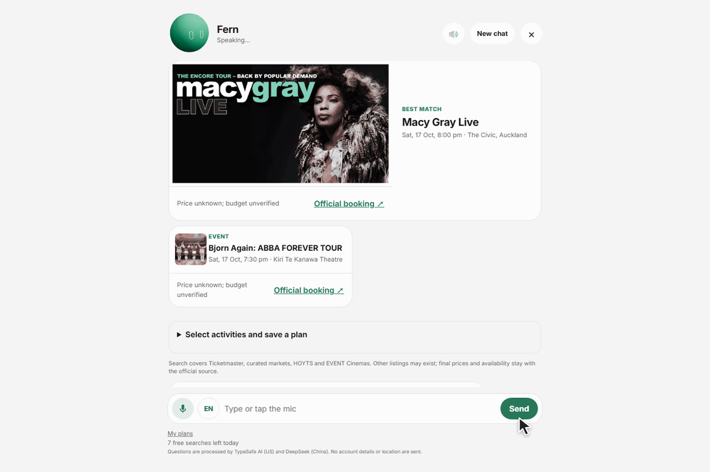
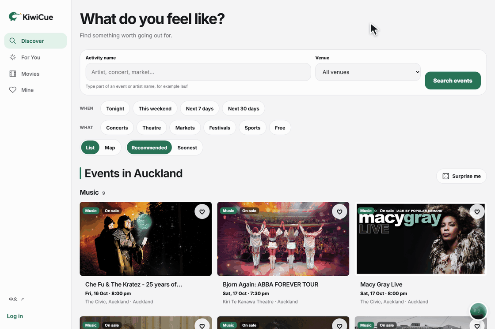
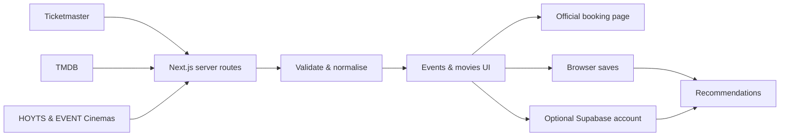

<div align="center">
  

  <h3>Your next Auckland outing starts with a conversation.</h3>

  <p>Meet five animated AI guides. Find concerts, movies and neighbourhood markets in English or Chinese.</p>

  <p>
    <a href="https://kiwicue.nz"><strong>🥝 Try KiwiCue →</strong></a> ·
    <a href="#meet-your-ai-guide">Meet the AI guides</a> ·
    <a href="#what-you-can-do">Features</a> ·
    <a href="#run-it-locally">Run locally</a>
  </p>

  <p><strong>English</strong> · <a href="./README.zh-CN.md">简体中文</a></p>

  <p>
    
    
    
    
    
  </p>
</div>

<p align="center">
  
</p>

<p align="center"><em>Five personalities. Animated 3D companions. A theme that follows your choice.</em><br /><a href="./docs/readme/ai-bot.jpg">View a still image</a></p>

---

## Try it live

Open [kiwicue.nz](https://kiwicue.nz) and click the assistant orb in the bottom-right corner. Pick a guide, then type a question or use the microphone in a supported browser. You can start as a guest.

Try **“Show me Auckland markets this weekend”** or **“这个周末带孩子去哪玩？”**

## Meet your AI guide

KiwiCue's AI bot is an outing companion with a face and a personality. Its animated 3D orb responds as it listens, thinks and speaks. Change assistants to change the site's colours, advice style and voice profile.

| Guide | Style | Colour |
| --- | --- | --- |
| **Iris** · Strategist | Calm, concise advice with a clear reason | Purple |
| **Rua** · Commander | Decisive, upbeat suggestions | Red |
| **Sunny** · Inventor | Playful ideas with a little wit | Yellow |
| **Fern** · Guardian | Warm advice with practical details | Green |
| **Kai** · Maker | Relaxed, direct and practical | Blue |

All five share the same search tools. Ask about events, movies or markets; refine your request in conversation, inspect the suggested options and follow official booking links. Voice input supports English and Chinese, and replies can be spoken aloud. Available voices depend on your browser and device.

The preview above shows real character selection, orb animation, theme changes and text/voice-language controls, with a visible mouse and click highlights. See [recording notes](./docs/readme/RECORDING.md) for the capture's scope and current API limitation.

## What you can do

| | |
| --- | --- |
| 🔎 **Discover** | Browse by category or tap a quick filter — *Tonight*, *This weekend*, *Free*, *Live music*, or *Surprise me*. Search by event name or venue. |
| 🗺️ **Plan** | See dates, venues and maps at a glance, then go straight to the official ticket page. |
| 🎬 **Movies** | See what's on at HOYTS and EVENT Cinemas across Auckland: every cinema showing a film, session times, screen types (LUX, Gold Class, V-Max…) and HOYTS ticket prices. |
| ⭐ **Picks & For You** | Get explainable recommendations — every pick says *why* it was suggested. |
| ❤️ **Save** | Save events without an account. Sign up to sync saves, collections and interests across devices. |
| 💬 **Social** *(optional)* | Mark events as Interested / Going / Went, comment, and share public collections. |
| 🌏 **Bilingual** | Switch between English and Simplified Chinese anywhere. |

Works on desktop and mobile. Browse manually whenever you prefer, and save events without creating an account.

<p align="center">
  
</p>

<details>
<summary><strong>Desktop and mobile screenshots</strong></summary>

<p align="center">
  
  &nbsp;
  
</p>

</details>

## Why KiwiCue

Auckland event information is scattered across ticketing sites, cinema pages, organisers and community groups. KiwiCue puts it in one place and keeps a few promises:

- **Soon first** — upcoming events appear while there's still time to plan and book.
- **Official sources** — final details and tickets always stay with the organiser or cinema.
- **Honest data** — verified sessions, previews, empty results and unavailable sources are clearly labelled.
- **Private by default** — guest saves and location stay in your browser; account data is private unless you choose to share.

## Where the data comes from

| Source | Used for |
| --- | --- |
| [Ticketmaster Discovery API](https://developer.ticketmaster.com/products-and-docs/apis/discovery-api/v2/) | Auckland events and official ticket links |
| KiwiCue verified schedules | Local markets and community events |
| [TMDB](https://www.themoviedb.org/) | Movie details, posters, ratings and trailers |
| [HOYTS](https://www.hoyts.co.nz/) and [EVENT Cinemas](https://www.eventcinemas.co.nz/) | Live Auckland sessions from each chain's own site, plus HOYTS ticket prices |

## How it works



API keys stay on the server — external data is fetched and validated in route handlers before it reaches the browser.

---

## Run it locally

**You need:** Node.js 20.9+, npm, and API keys for Ticketmaster and TMDB. Cinema sessions need no key.

```bash
git clone https://github.com/hannnnnnnny/kiwicue.git
cd kiwicue
npm ci
cp .env.example .env.local   # then fill in the keys below
npm run dev                  # http://localhost:3000
```

On Windows PowerShell, use `Copy-Item .env.example .env.local` for the environment-file step.

```env
TICKETMASTER_API_KEY=your_ticketmaster_consumer_key
TMDB_READ_ACCESS_TOKEN=your_tmdb_read_access_token
```

> [!IMPORTANT]
> These are server-only secrets. Never prefix them with `NEXT_PUBLIC_`, commit `.env.local`, or print them in logs.

Browsing, search and guest saves work with just these keys. Accounts are optional — see below.

<details>
<summary><strong>Enable accounts (Supabase + email)</strong></summary>

<br />

1. **Database** — create a Supabase project and apply every file in `supabase/migrations/` in filename order.
2. **Environment variables** (locally and in Vercel):

   ```env
   NEXT_PUBLIC_SUPABASE_URL=https://your-project.supabase.co
   NEXT_PUBLIC_SUPABASE_PUBLISHABLE_KEY=your_publishable_key
   SUPABASE_SECRET_KEY=your_server_only_secret_key
   ```

   The secret key is used only on the server (signup status, resend, account deletion). The legacy `SUPABASE_SERVICE_ROLE_KEY` still works as a fallback.
3. **URL configuration** — set the Site URL to your domain and allow these redirect URLs for each origin:
   `/auth/confirmed`, `/auth/callback?next=/account`, `/auth/callback?next=/reset-password`.
4. **Email delivery** — Supabase's built-in email only reaches your own team and sends ~2 emails/hour. For real users, enable **custom SMTP** (KiwiCue uses [Resend](https://resend.com) with a verified sending domain).
5. **Reset-password email template** — point the link at the server-side confirm route so it works on any device:

   ```text
   {{ .SiteURL }}/auth/confirm?token_hash={{ .TokenHash }}&type=recovery
   ```

6. **AI bot (optional)** — the assistant also needs the Supabase public configuration, server secret and all migrations from your checked-out branch. Set `TYPESAFE_AI_API_KEY`, `DEEPSEEK_API_KEY` and `ASK_HASH_SALT` (a random string of 16+ characters) as Sensitive server variables and redeploy. Start with `supabase/migrations/202610010001_ask_usage.sql` and apply later migrations in filename order. Search quotas and spending budgets are configured in `ask_limits` and `ask_settings`. The launcher appears only when the required configuration is present; verify an actual question after setup to check database permissions, quota functions and providers.

7. **Kiwi** — also apply `supabase/migrations/202610010002_ask_chat.sql` and `202610010003_ask_free_quota.sql`. The assistant (five to choose from, each re-themes the site) holds a real conversation: DeepSeek reads the last 12 turns and what is on screen, calls the search tool only when the visitor wants something or changes what they want, and replies in its own voice, opening with a hidden `[[mood]]` tag that the 3D assistant acts out (it also shows searching and error states, follows the pointer and dozes when idle). Each message uses one question from the daily quota.

**How sign-up works:** after signing up, the original tab waits (up to 15 minutes) while you confirm the email — on any device — then signs in automatically. Signing up with an already-registered email sends no email by design (to avoid revealing which emails have accounts); the page offers log-in and password-reset links instead.

**Privacy:** profiles and collections start private. Activity tracking is off by default; turning it off deletes existing records. Search text, credentials and precise location are never stored.

Before enabling accounts in production, verify signup → login → sync → RLS → deletion with two separate test users. No credentials are included in this repository.

</details>

<details>
<summary><strong>Routes</strong></summary>

<br />

| Route | What it is |
| --- | --- |
| `/` · `/events` | Event discovery: quick filters, search, categories and time windows |
| `/events/[eventId]` | Event details, venue map and official links |
| `/recommendations` | Explainable picks |
| `/for-you` | Recommendations from your chosen interests |
| `/movies` · `/movies/[movieId]` | Cinema sessions, releases, movie details and trailers |
| `/saved` | Saved events (browser-local, or synced when signed in) |
| `/collections` · `/u/[username]` | Private-by-default collections and opt-in public profiles |
| `/account` · `/notifications` | Profile, interests, privacy, notifications and account deletion |
| `/signup` · `/login` · `/forgot-password` | Account access |

</details>

<details>
<summary><strong>Project structure & tech stack</strong></summary>

<br />

```text
kiwicue/
├── app/            # App Router pages and server API routes
├── components/     # UI components
├── lib/            # API clients, validation and domain logic
├── supabase/       # Database migrations
├── public/brand/   # Logo assets
├── tests/          # Unit, component and integration tests (Vitest)
└── e2e/            # End-to-end tests (Playwright)
```

Next.js 16 (App Router) · React 19 · TypeScript 5 · modular CSS · Supabase Auth, PostgreSQL & RLS · Resend SMTP · Vitest + Testing Library · Playwright · Vercel

</details>

## Testing

```bash
npm test            # unit, component and integration tests
npm run test:e2e    # end-to-end tests
npm run lint
npm run build
```

<details>
<summary><strong>Regenerate the README previews</strong></summary>

The capture uses Playwright from this repository and Python with Pillow. It records a fresh guest session on [kiwicue.nz](https://kiwicue.nz), adds a visible mouse and click highlights, and writes temporary frames under the ignored `output/playwright/` directory.

```bash
npx playwright install chromium
node scripts/capture-readme-demo.mjs
python scripts/encode-readme-demo.py ai
python scripts/encode-readme-demo.py demo
```

This updates the two GIFs and the still images in `docs/readme/`. The default AI preview demonstrates the interface without submitting a paid AI request. For a live question and recommendation capture, use `node scripts/capture-readme-demo.mjs --with-reply` after checking service availability; this uses the normal AI quota and provider budget. See [recording notes](./docs/readme/RECORDING.md) for details.

</details>

## Deployment

KiwiCue deploys to Vercel from this repository and is served at [kiwicue.nz](https://kiwicue.nz).

Add `TICKETMASTER_API_KEY` and `TMDB_READ_ACCESS_TOKEN` as **Sensitive** production environment variables. If accounts are enabled, add the Supabase variables and apply migrations first.

```bash
vercel link --yes --project kiwicue
vercel deploy --prod --yes
```

## Licence

No open-source licence has been added. All rights reserved unless a licence is added later.

---

<p align="center">Designed and developed by <a href="https://github.com/hannnnnnnny">Harry Han</a> in Auckland 🇳🇿</p>
