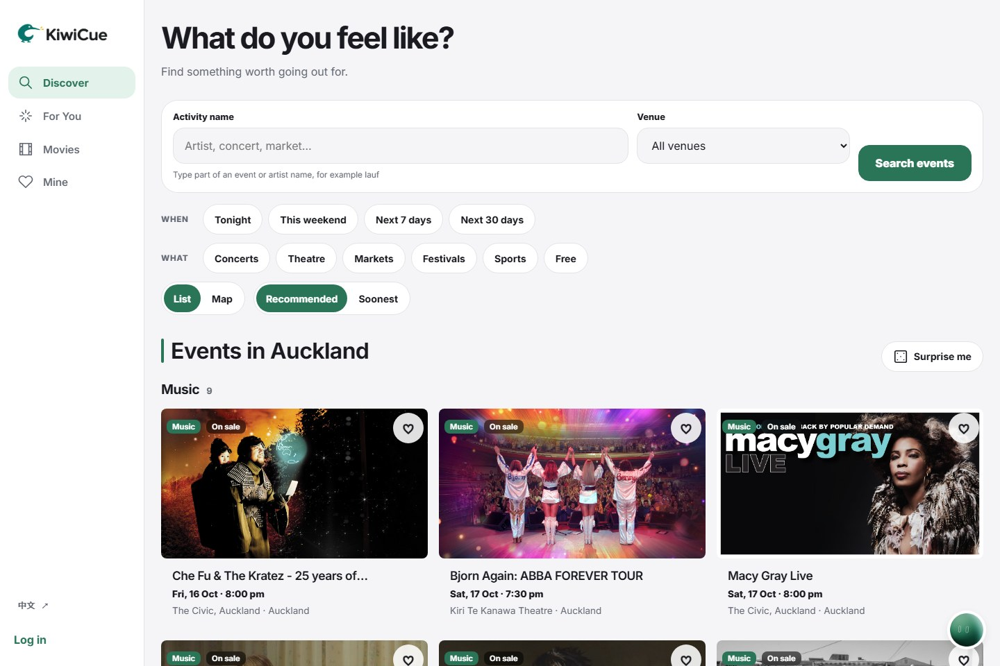
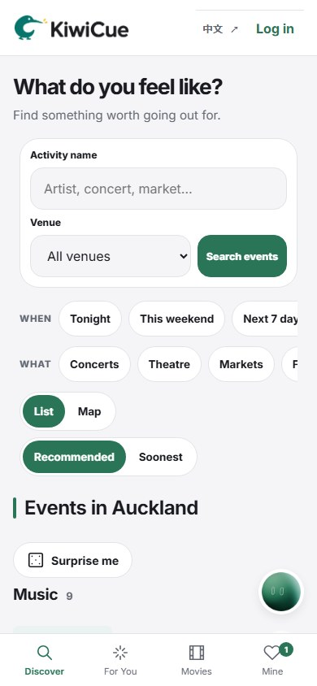
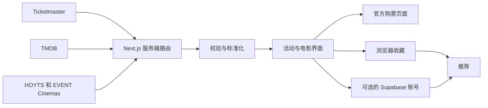

<div align="center">
  

  <h3>在奥克兰，找点值得出门的事。</h3>

  <p>演唱会、话剧、市集、节日和电影，汇集在一个中英双语指南里，按时间先后排好。</p>

  <p>
    <a href="https://kiwicue.nz"><strong>🥝 打开 kiwicue.nz →</strong></a>
  </p>

  <p><a href="./README.md">English</a> · <strong>简体中文</strong></p>
</div>

<p align="center">
  
  &nbsp;
  
</p>

---

## 能做什么

| | |
| --- | --- |
| 🔎 **发现** | 按分类浏览，或点快捷筛选：*今晚*、*这个周末*、*免费*、*现场音乐*、*随便看看*。可按活动名或场馆搜索。 |
| 🗺️ **规划** | 日期、场馆、地图一目了然，一键跳转官方购票页面。 |
| 🎬 **电影** | 查看奥克兰 HOYTS 和 EVENT Cinemas 正在放映的电影：哪些影院在放、场次时间、影厅类型（LUX、Gold Class、V-Max 等）以及 HOYTS 票价。 |
| ⭐ **精选与为你推荐** | 推荐结果可解释 —— 每条都会说明 *为什么* 推荐给你。 |
| ❤️ **收藏** | 不注册也能收藏活动；注册后可在多台设备间同步收藏、合集和兴趣。 |
| 💬 **社交**（可选） | 标记“感兴趣 / 要去 / 去过”，发表评论，分享公开合集。 |
| 🌏 **双语** | 随时在英文和简体中文之间切换。 |

桌面端使用左侧导航，手机端使用底部标签栏。

## 为什么做 KiwiCue

奥克兰的活动信息分散在各个票务网站、影院页面、主办方和社区群里。KiwiCue 把它们放到一个地方，并坚持几个原则：

- **近期优先** —— 即将开始的活动排在前面，留出计划和订票的时间。
- **以官方为准** —— 最终信息和购票始终以主办方或影院为准。
- **数据诚实** —— 已核实的场次、预告、空结果和不可用的数据源都会明确标注。
- **默认私密** —— 访客收藏和位置只保存在你的浏览器里；账号数据默认私密，除非你主动分享。

## 数据来源

| 来源 | 用途 |
| --- | --- |
| [Ticketmaster Discovery API](https://developer.ticketmaster.com/products-and-docs/apis/discovery-api/v2/) | 奥克兰活动和官方购票链接 |
| KiwiCue 核实的日程 | 本地市集和社区活动 |
| [TMDB](https://www.themoviedb.org/) | 电影详情、海报、评分和预告片 |
| [HOYTS](https://www.hoyts.co.nz/) 和 [EVENT Cinemas](https://www.eventcinemas.co.nz/) | 来自两家院线官网的奥克兰实时场次，以及 HOYTS 票价 |

## 工作原理



API 密钥只留在服务端 —— 外部数据在路由处理器里获取并校验后，才会发送到浏览器。

---

## 本地运行

**需要：** Node.js 20+、npm，以及 Ticketmaster 和 TMDB 的 API 密钥。影院场次不需要密钥。

```bash
git clone https://github.com/hannnnnnnny/kiwicue.git
cd kiwicue
npm install
cp .env.example .env.local   # 然后填入下面的密钥
npm run dev                  # http://localhost:3000
```

```env
TICKETMASTER_API_KEY=your_ticketmaster_consumer_key
TMDB_READ_ACCESS_TOKEN=your_tmdb_read_access_token
```

> [!IMPORTANT]
> 这些都是仅限服务端的密钥。不要加 `NEXT_PUBLIC_` 前缀，不要提交 `.env.local`，也不要打印到日志里。

只配这些密钥就能浏览、搜索和访客收藏。账号功能是可选的，见下文。

<details>
<summary><strong>启用账号（Supabase + 邮件）</strong></summary>

<br />

1. **数据库** —— 创建一个 Supabase 项目，按文件名顺序执行 `supabase/migrations/` 里的所有文件。
2. **环境变量**（本地和 Vercel 都要配）：

   ```env
   NEXT_PUBLIC_SUPABASE_URL=https://your-project.supabase.co
   NEXT_PUBLIC_SUPABASE_PUBLISHABLE_KEY=your_publishable_key
   SUPABASE_SECRET_KEY=your_server_only_secret_key
   ```

   Secret key 只在服务端使用（注册状态、重发邮件、删除账号）。旧的 `SUPABASE_SERVICE_ROLE_KEY` 仍可作为备用。
3. **URL 配置** —— 把 Site URL 设为你的域名，并为每个域名允许以下跳转地址：
   `/auth/confirmed`、`/auth/callback?next=/account`、`/auth/callback?next=/reset-password`。
4. **邮件发送** —— Supabase 自带的邮件只能发给你自己的团队成员，而且每小时约 2 封。面向真实用户时，请开启 **自定义 SMTP**（KiwiCue 使用 [Resend](https://resend.com) 和已验证的发件域名）。
5. **重置密码邮件模板** —— 把链接指向服务端确认路由，这样在任何设备上都能打开：

   ```text
   {{ .SiteURL }}/auth/confirm?token_hash={{ .TokenHash }}&type=recovery
   ```

6. **语音问答（可选）** —— 执行 `supabase/migrations/202610010001_ask_usage.sql`，再把 `TYPESAFE_AI_API_KEY`、`DEEPSEEK_API_KEY` 和 `ASK_HASH_SALT`（16 位以上的随机字符串）设为 Sensitive 环境变量并重新部署。三者都设置后才会显示麦克风按钮。次数额度（未登录每天 15 次、登录 50 次）和每天 NZ$0.50、每月 NZ$8 的预算保存在 `ask_limits` 和 `ask_settings` 表里，修改不需要重新部署。

7. **Kiwi** —— 再执行 `supabase/migrations/202610010002_ask_chat.sql` 和 `202610010003_ask_free_quota.sql`。圆形语音向导 Kiwi 每条消息都会直接搜索：第一句开始搜索，之后每一句都在当前结果上继续调整，然后 Kiwi 会追问还缺的信息（哪天、哪一片），可以直接点选回答。每条消息占用一次每日搜索额度。

**注册流程：** 注册后，原来的页面会等待（最多 15 分钟），你在任意设备上确认邮件后，它会自动登录。用已注册的邮箱再次注册时，按设计不会发送邮件（避免暴露哪些邮箱有账号），页面会提供登录和重置密码的入口。

**隐私：** 个人资料和合集默认私密。活动记录默认关闭，关闭时会删除已有记录。搜索内容、登录凭据和精确位置永远不会被保存。

在生产环境启用账号前，请用两个独立的测试用户验证：注册 → 登录 → 同步 → RLS → 删除。本仓库不包含任何凭据。

</details>

<details>
<summary><strong>页面路由</strong></summary>

<br />

| 路由 | 内容 |
| --- | --- |
| `/` · `/events` | 活动发现：快捷筛选、搜索、分类和时间范围 |
| `/events/[eventId]` | 活动详情、场馆地图和官方链接 |
| `/recommendations` | 可解释的精选推荐 |
| `/for-you` | 基于你所选兴趣的推荐 |
| `/movies` · `/movies/[movieId]` | 影院场次、新片、电影详情和预告片 |
| `/saved` | 已收藏的活动（保存在浏览器，登录后同步） |
| `/collections` · `/u/[username]` | 默认私密的合集，以及可选公开的个人主页 |
| `/account` · `/notifications` | 个人资料、兴趣、隐私、通知和删除账号 |
| `/signup` · `/login` · `/forgot-password` | 账号入口 |

</details>

<details>
<summary><strong>项目结构与技术栈</strong></summary>

<br />

```text
kiwicue/
├── app/            # App Router 页面和服务端 API 路由
├── components/     # UI 组件
├── lib/            # API 客户端、校验和业务逻辑
├── supabase/       # 数据库迁移
├── public/brand/   # Logo 资源
├── tests/          # 单元、组件和集成测试（Vitest）
└── e2e/            # 端到端测试（Playwright）
```

Next.js 16（App Router）· React 19 · TypeScript 5 · 模块化 CSS · Supabase Auth、PostgreSQL 与 RLS · Resend SMTP · Vitest + Testing Library · Playwright · Vercel

</details>

## 测试

```bash
npm test            # 单元、组件和集成测试
npm run test:e2e    # 端到端测试
npm run lint
npm run build
```

## 部署

KiwiCue 从本仓库部署到 Vercel，网址为 [kiwicue.nz](https://kiwicue.nz)。

在 Vercel 中把 `TICKETMASTER_API_KEY` 和 `TMDB_READ_ACCESS_TOKEN` 添加为 **Sensitive** 类型的生产环境变量。如果启用了账号功能，先添加 Supabase 变量并执行数据库迁移。

```bash
vercel link --yes --project kiwicue
vercel deploy --prod --yes
```

## 许可

尚未添加开源许可证。在添加许可证之前，保留所有权利。

---

<p align="center">由 <a href="https://github.com/hannnnnnnny">Harry Han</a> 在奥克兰设计和开发 🇳🇿</p>
